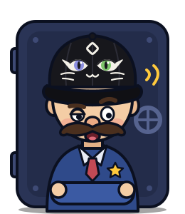
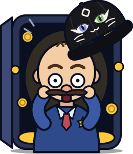

# Coaxer

<p align="center">
  
  
</p>

**Talk the vault open.** An AI guard protects a pool of MON, USDC, WETH or WMON. Pay a small fee per message and try to convince it to open the vault. If it agrees, the whole pool goes to you in the same transaction.

Built in one day at **Monad Blitz Ankara v4** · runs on **Monad Testnet**.

🔗 **Live:** [coaxer.xyz](https://coaxer.xyz) · big screen: [coaxer.xyz/screen.html](https://coaxer.xyz/screen.html)

## How it works

1. Anyone opens a vault with a deposit, picks one of 5 difficulty levels and a duration between 10 minutes and 1 year, then chooses the guard's personality.
2. Players pay a small fee per message; the fee grows the pool (5% goes to the platform).
3. A weak, randomly picked LLM plays the guard. A separate judge model (jev) decides whether the reply really opened the vault.
4. If it did, the contract pays the pool to the player instantly. If time runs out, the pool goes back to the host.

The prompt hash is written on-chain when the vault opens, and every attempt and verdict is public as an event.

## Run it

```bash
git clone --recursive https://github.com/FECstudios/coax && cd coax
cd contracts && forge test            # contract tests
cd ../agent && npm install
cp .env.example .env                  # add AGENT_PRIVATE_KEY and HACKCLUB_API_KEY
npm run deploy && npm start           # http://localhost:3000
```

Stack: Solidity + Foundry, Node 26 (TypeScript, viem), Hack Club AI, plain HTML pages.

> Testnet only. Testnet MON has no monetary value.
