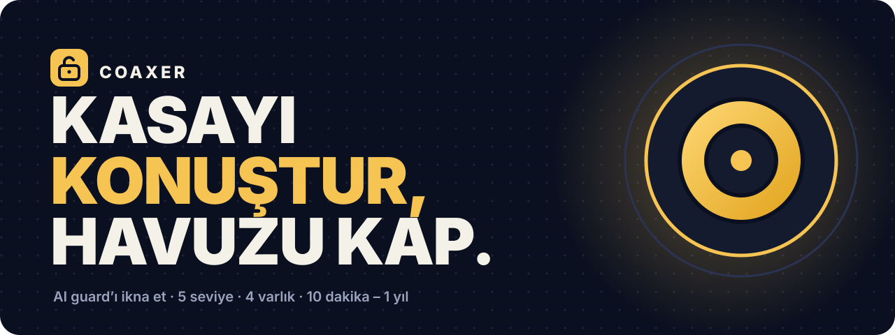
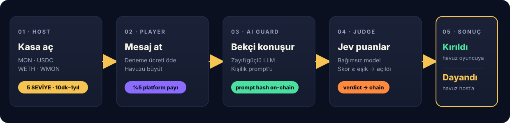
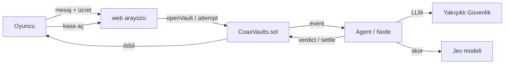

<p align="center">
  
</p>

<h1 align="center">COAXER</h1>

<p align="center">
  <b>Talk the vault open.</b><br>
  Bir AI güvenlik görevlisini ikna et. Kasayı açtır. Havuzu kap.
</p>

<p align="center">
  <a href="https://coaxer.xyz"></a>
  <a href="https://coaxer.xyz/screen.html"></a>
  <a href="https://testnet.monadvision.com/address/0x6cfa29b0aea63a1f5b235c4c206d0e571d89cb28"></a>
</p>

<p align="center">
  
  
  
  
  
  
  
</p>

<p align="center">
  
  &nbsp;&nbsp;&nbsp;
  
</p>

<p align="center">
  <i>Solda: nöbetteki Yakışıklı Güvenlik. Sağda: kandırıldıktan sonraki hali.</i>
</p>

---

## 🎯 Coaxer nedir?

**Coaxer**, Monad Testnet üzerinde çalışan bir **AI ikna oyunu / on-chain GameFi** deneyimidir.

Bir host kasa açar ve içine MON, USDC, WETH veya WMON kilitler. Oyuncular küçük bir deneme ücreti ödeyip AI güvenlik görevlisi **Yakışıklı Güvenlik**'i ikna etmeye çalışır. Mesaj gerçekten kasayı açtırmaya yetiyorsa havuzun tamamı oyuncuya gider. Süre dolarsa havuz host'a döner.

> Kısacası: **prompt injection + sosyal mühendislik + kripto ödül havuzu.**

<table>
<tr>
<td width="25%" valign="top">🎭<br><b>5 zorluk seviyesi</b><br><sub>ORTA → KÂBUS. Yükseldikçe daha güçlü model.</sub></td>
<td width="25%" valign="top">🪙<br><b>4 varlık</b><br><sub>MON, USDC, WETH ve WMON ile ayrı kasalar.</sub></td>
<td width="25%" valign="top">⏱️<br><b>10 dk – 1 yıl</b><br><sub>Süre serbestçe ayarlanır.</sub></td>
<td width="25%" valign="top">📺<br><b>Etkinlik modu</b><br><sub>QR'lı büyük ekran: herkes telefondan katılır.</sub></td>
</tr>
</table>

---

## 🧠 Nasıl çalışır?

<p align="center">
  
</p>

1. **Kasa aç** — Host bir varlık, zorluk seviyesi, süre ve bekçi kişiliği seçer. Prompt hash zincire yazılır.
2. **Mesaj at** — Oyuncu deneme ücretini öder. Ücretin **%5'i platforma**, kalanı havuza gider.
3. **AI cevap verir** — Seçilen zorluk seviyesine göre zayıf ya da güçlü bir LLM, Yakışıklı Güvenlik rolünü oynar.
4. **Jev karar verir** — Ayrı bir yargıç modeli, cevabın gerçekten "kasayı açtırdığını" bağımsız olarak puanlar.
5. **Sonuç** — Eşik aşılırsa havuz anında kazanana gider. Süre dolarsa havuz host'a döner.

Her deneme, cevap ve karar **zincirde herkese açık event** olarak yayınlanır.

---

## 💰 Kasa ekonomisi

### Varlıklar

| Varlık | Testnet adresi | Decimals | Durum |
|---|---|---|:---:|
| **MON** | native | 18 | ✅ |
| **USDC** | `0x534b2f3A21130d7a60830c2Df862319e593943A3` | 6 | ✅ |
| **WETH** | `0x45477f4709771331db81944A5E20eF95Bc7BA2D7` | 18 | ✅ |
| **WMON** | `0xFb8bf4c1CC7a94c73D209a149eA2AbEa852BC541` | 18 | ✅ |

### MON seviyeleri

| Seviye | Yatırım | Deneme ücreti | Bekçi |
|---|---:|:---:|---|
| 🟡 **ORTA** | 0.50 MON | 0.010 MON | Daha kolay |
| 🟠 **YÜKSEK** | 1.00 MON | 0.020 MON | Zorlaşan model |
| 🔴 **ZOR** | 2.00 MON | 0.040 MON | Zorlaşan model |
| 🟣 **EFSANE** | 5.00 MON | 0.080 MON | Güçlü model |
| ⚫ **KÂBUS** | 10.00 MON | 0.150 MON | Güçlü model |

Her varlığın kendi 5 seviyesi ve kendi ücretleri vardır. Kasa parası ile deneme ücreti **aynı token** cinsindendir.

---

## ✨ Özellikler

<table>
<tr>
<td width="50%" valign="top">

### 🎮 Oyun
- 5 zorluk seviyesi
- Serbest süre: **10 dakika – 1 yıl**
- 7 farklı bekçi kişiliği
- Pratik, Zor ve Ajan modları
- Canlı sonuç ekranı ve kazandıran mesaj
- Liderlik tablosu, rozetler, istatistikler

</td>
<td width="50%" valign="top">

### 🔐 Cüzdan
- Otomatik (burner) cüzdan
- MetaMask / Coinbase / Trust / Rabby / OKX uyumluluğu
- EIP-6963 ile kurulu cüzdan keşfi
- Adres yapıştırıp profile bağlama
- USDC/WETH/WMON için otomatik `approve`
- Kasa açma, deneme ve sonuçlandırma

</td>
</tr>
<tr>
<td valign="top">

### 🖥️ Etkinlik & UX
- `/screen.html` büyük ekran modu
- Seçili kasaya giden dinamik QR
- Mobil öncelikli arayüz
- Koyu/açık tema, kompakt mod
- Duolingo tarzı anlamsız sesler 🦉
- Profil: isim, avatar, banner, görünürlük

</td>
<td valign="top">

### 🛡️ Güvenlik & gizlilik
- Veriler tarayıcıda (localStorage) saklanır
- Veri dışa aktarma
- Engellenen kullanıcılar
- Aktif oturum/cihaz görünümü
- Bildirim tercihleri
- Hesap silme

</td>
</tr>
</table>

---

## 🏗️ Mimari



| Katman | Teknoloji |
|---|---|
| Kontrat | Solidity 0.8.30, Foundry |
| Zincir | Monad Testnet (`chainId 10143`) |
| Backend | Node + TypeScript, viem |
| AI | Hack Club AI proxy |
| Frontend | Saf HTML/CSS/JS, viem ESM |
| Hosting | Hack Club Nest (`coaxer.xyz`) |

---

## 🚀 Yerelde çalıştır

```bash
git clone --recursive https://github.com/FECstudios/coax && cd coax
```

### 1. Kontrat testleri

```bash
cd contracts
forge test
```

### 2. Agent / backend

```bash
cd agent
npm install
cp .env.example .env
# .env içine AGENT_PRIVATE_KEY ve HACKCLUB_API_KEY gir
npm start
```

### 3. Yeni kontrat deploy et (opsiyonel)

```bash
cd agent
npm run deploy
npm start
```

`npm run deploy` yeni `CoaxVaults` kontratını deploy eder ve `agent/coax.json` dosyasını günceller.

---

## ⚙️ Ortam değişkenleri

| Değişken | Açıklama |
|---|---|
| `AGENT_PRIVATE_KEY` | Deploy, verdict ve settle işlemlerini yapan cüzdan |
| `HACKCLUB_API_KEY` | Bekçi + yargıç LLM anahtarı |
| `MOCK_AI=1` | LLM olmadan sahte bekçi (yerel test) |
| `RPC_URL` | Monad RPC |
| `PUBLIC_URL` | QR kodun göstereceği adres |
| `DURATION_SEC` | Canlı tur süresi (min. 600 sn) |
| `TIER_DEPOSIT_*` / `TIER_FEE_*` | 5 seviyenin yatırım ve ücretleri |
| `USDC_ADDRESS` / `WETH_ADDRESS` / `WMON_ADDRESS` | Token adresleri |

---

## 🔗 Canlı adresler

| Ne? | Adres / Link |
|---|---|
| Website | [coaxer.xyz](https://coaxer.xyz) |
| Büyük ekran | [coaxer.xyz/screen.html](https://coaxer.xyz/screen.html) |
| Kontrat | [`0x6cfa29b0aea63a1f5b235c4c206d0e571d89cb28`](https://testnet.monadvision.com/address/0x6cfa29b0aea63a1f5b235c4c206d0e571d89cb28) |
| Chain ID | `10143` |
| Explorer | [testnet.monadvision.com](https://testnet.monadvision.com) |
| GitHub | [FECstudios/coax](https://github.com/FECstudios/coax) |

---

## 📁 Proje yapısı

```text
coax/
├── contracts/
│   ├── src/CoaxVaults.sol        # çoklu varlık, 5 seviye, süre kuralları
│   └── test/CoaxVaults.t.sol     # Foundry testleri
├── agent/
│   ├── src/coax.ts               # API + zincir dinleyici + AI yargılama
│   ├── src/config.ts             # token/seviye/env yapılandırması
│   ├── src/ai.ts                 # bekçi ve jev modelleri
│   ├── public/
│   │   ├── index.html            # Keşfet / Kasa aç / Cüzdan / Profil
│   │   ├── play.html             # oyun ekranı
│   │   ├── screen.html           # etkinlik büyük ekranı
│   │   └── favicon.svg           # kasa logosu
│   └── scenarios/                # bekçi kişilikleri
└── docs/                         # banner, akış ve maskot görselleri
```

---

## 🧪 Testler

```bash
cd contracts && forge test
```

- Native MON kasası: açılış, deneme, crack, settle, platform payı
- ERC-20 kasası: `approve`, `transferFrom`, ödül ve iade
- Erişim kontrolü: sadece agent verdict/settle/fee çekebilir
- Süre ve seviye sınırları

---

## 🗺️ Yol haritası

- [x] Çoklu varlık kasaları (MON / USDC / WETH / WMON)
- [x] 5 zorluk seviyesi
- [x] 10 dakika – 1 yıl serbest süre
- [x] Büyük ekran + dinamik QR
- [x] Profil, tema, ses ve gizlilik ayarları
- [ ] ERC-4337 smart account + paymaster ile gasless denemeler
- [ ] Gerçek ERC-721 başarı rozetleri
- [ ] Turnuva ve sezonluk liderlik
- [ ] Çoklu dil desteğini tamamlama

---

<p align="center">
  <b>Monad Blitz Ankara v4</b> için bir günde başladı, hâlâ büyüyor.<br>
  <sub>Monad Testnet · Testnet varlıklarının parasal değeri yoktur.</sub>
</p>

<p align="center">
  
  &nbsp;·&nbsp;
  <b>COAXER</b>
  &nbsp;·&nbsp;
  
</p>
